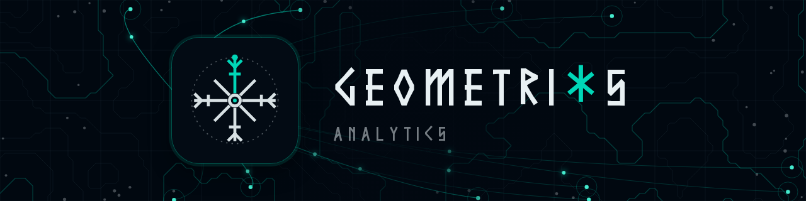
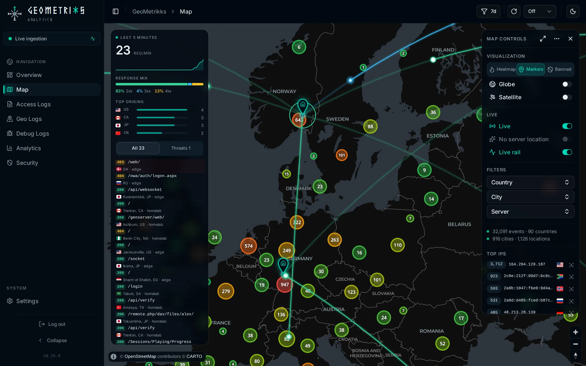
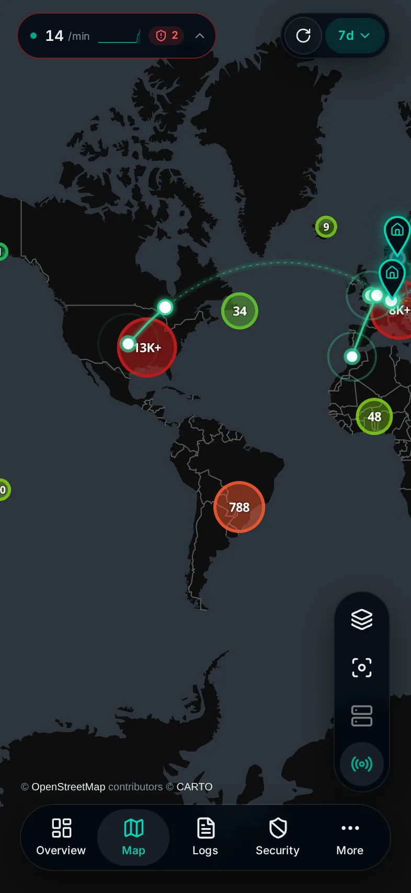

<h1 align="center">
  <picture>
    <source media="(prefers-color-scheme: light)" srcset="resources/static/brand/readme-banner-light.png">
    
  </picture>
</h1>

GeoMetrikks tails your reverse-proxy access logs (nginx, Nginx Proxy
Manager, Traefik and Caddy) or reads them from Grafana Loki, geolocates
every request with MaxMind GeoLite2, and shows the result on a
real-time map and a traffic analytics dashboard. It runs on your own
hardware from one Docker image.

<p align="center">
  <picture>
    <source media="(prefers-color-scheme: light)" srcset="data/screenshots/live-desktop-light.webp">
    
  </picture>
  <picture>
    <source media="(prefers-color-scheme: light)" srcset="data/screenshots/live-phone-light.webp">
    
  </picture>
</p>

## Quickstart

You need Docker. The image is published to GHCR for `amd64` and `arm64`.

```bash
mkdir geometrikks && cd geometrikks
curl -LO https://raw.githubusercontent.com/GilbN/geometrikks/main/docker-compose.yml
curl -Lo .env https://raw.githubusercontent.com/GilbN/geometrikks/main/.env.example
$EDITOR .env      # set APP_ADMIN_PASSWORD, MaxMind key, CARTO key, log path
docker compose up -d
```

Open http://localhost:8000 and log in with `APP_ADMIN_USER` / `APP_ADMIN_PASSWORD`.
The [Quickstart](https://geometrikks.dev/docs/get-started/quickstart/) covers the GeoLite2 keys, log paths and image tags.

## Integrations

- **Reverse proxies.** Tails the access logs of [nginx](https://geometrikks.dev/docs/sources/nginx/), [Nginx Proxy Manager](https://geometrikks.dev/docs/sources/nginx-proxy-manager/), [Traefik](https://geometrikks.dev/docs/sources/traefik/) (Pangolin included) and [Caddy](https://geometrikks.dev/docs/sources/caddy/).
- **[Grafana Loki](https://geometrikks.dev/docs/sources/loki/).** Reads proxy logs your Loki already collects, instead of or next to log files.
- **[CrowdSec](https://geometrikks.dev/docs/features/crowdsec/).** Shows decisions and alerts from your Local API next to the traffic behind them, and bans or unbans an IP from the map, the tables or the IP inspector.
- **[Spamhaus DROP](https://geometrikks.dev/docs/features/drop-lists/).** Marks traffic from networks on the DROP and ASN-DROP lists, ready to ban through CrowdSec.
- **[AbuseIPDB](https://geometrikks.dev/docs/features/abuseipdb/).** Shows an IP's abuse score in the IP inspector, marks IPs on AbuseIPDB's blacklist, and reports an IP to AbuseIPDB from its actions menu.
- **[MaxMind GeoLite2](https://geometrikks.dev/docs/get-started/geolite2/).** Places requests on the map and names the network each came from. With a free MaxMind key, the databases download and refresh on their own.
- **[OpenID Connect](https://geometrikks.dev/docs/features/authentication/oidc/).** Single sign-on through Authelia, Authentik, Keycloak, Pocket ID, Google or another provider.
- **[API keys](https://geometrikks.dev/docs/features/authentication/api-keys/).** Read or read/write keys for scripts and dashboard widgets that call the REST API.
- **[Abuse reports](https://geometrikks.dev/docs/features/abuse-reports/).** Builds a report for a network's abuse desk and looks up the contact address over RDAP.

## Documentation

The docs live at [geometrikks.dev/docs](https://geometrikks.dev/docs/). The [configuration reference](https://geometrikks.dev/docs/reference/configuration/) lists every setting with its default.

## Project

- [Changelog](CHANGELOG.md)
- [Security policy](SECURITY.md)
- [MIT License](LICENSE)
