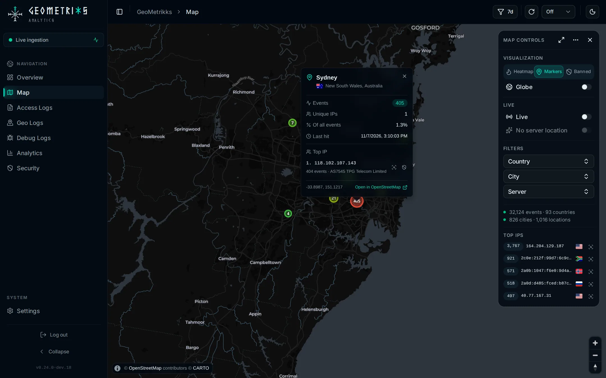
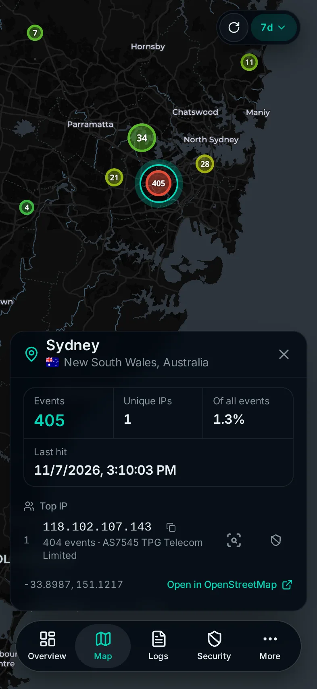

<h1 align="center">
  <picture>
    <source media="(prefers-color-scheme: light)" srcset="resources/static/brand/readme-banner-light.png">
    
  </picture>
</h1>

GeoMetrikks tails your reverse-proxy access logs (nginx, Nginx Proxy
Manager, Traefik and Caddy) or reads them from Grafana Loki, geolocates
every request with MaxMind GeoLite2, and shows the result on a
real-time map and a traffic analytics dashboard. It runs on your own
hardware from one Docker image. On its own, the server downloads
GeoLite2, looks up its public IP for the map's server location, checks
GitHub for a new release and downloads the Spamhaus DROP lists. It makes
RDAP lookups only when you ask for an abuse contact. The
[Introduction](https://geometrikks.dev/docs/#outbound-traffic) says where
each request goes and how to turn it off. If you run CrowdSec, connect
its Local API and manage bans next to the traffic that caused them.

<p align="center">
  <picture>
    <source media="(prefers-color-scheme: light)" srcset="data/screenshots/map-desktop-light.webp">
    
  </picture>
  <picture>
    <source media="(prefers-color-scheme: light)" srcset="data/screenshots/map-phone-light.webp">
    
  </picture>
</p>

## Quickstart

You need Docker. The image is published to GHCR for `amd64` and `arm64`.

```bash
mkdir geometrikks && cd geometrikks
curl -LO https://raw.githubusercontent.com/GilbN/geometrikks/main/docker-compose.yml
curl -Lo .env https://raw.githubusercontent.com/GilbN/geometrikks/main/.env.example
$EDITOR .env      # set APP_ADMIN_PASSWORD, MaxMind key, CARTO key, log path
docker compose up -d
```

Open http://localhost:8000 and log in with `APP_ADMIN_USER` / `APP_ADMIN_PASSWORD`.
The [Quickstart](https://geometrikks.dev/docs/get-started/quickstart/) covers the GeoLite2 keys, log paths and image tags.

## Documentation

The docs live at [geometrikks.dev/docs](https://geometrikks.dev/docs/). Good places to start:

- [Log sources](https://geometrikks.dev/docs/sources/nginx/) has a setup page for nginx, Nginx Proxy Manager, Traefik, Caddy and Loki.
- [CrowdSec](https://geometrikks.dev/docs/features/crowdsec/) covers connecting the Local API, the Security page and banning or unbanning from the app.
- The [configuration reference](https://geometrikks.dev/docs/reference/configuration/) lists every setting with its default.

## Project

- [Changelog](CHANGELOG.md)
- [Security policy](SECURITY.md)
- [MIT License](LICENSE)
